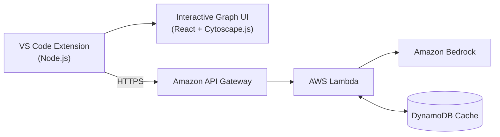

  
  <h1 align="center">CodeChronicle ⚡</h1>
  
<strong>AI-Powered VS Code Extension that helps developers understand and navigate unfamiliar codebases directly within their IDE</strong>

  
  
  
  
  
  

---

## Overview

CodeChronicle is an AI-powered VS Code extension that helps developers understand and navigate unfamiliar codebases without leaving their IDE. It has **1,500+ installations** across multiple IDE marketplaces.

**Website:** [https://codechronicle-seven.vercel.app/](https://codechronicle-seven.vercel.app/)

---

## Features

### Plain-English File Summaries
Get a short, plain-English explanation of what any file does and why it exists, generated by Amazon Bedrock.

### Code Risk Scoring
See how risky a file is to change before you touch it.

### Ask Your Codebase
Ask questions about your project in plain English and get answers grounded in your actual code.

### Blast Radius Analysis
A dependency analysis engine uses **BFS traversal** over the dependency graph to trace both the **direct and indirect** impact of changing a file, so you know exactly what could break.

### Interactive Dependency Graph
Explore your codebase and its blast radius visually through an interactive interface built with **React** and **Cytoscape.js**.

### Smart Caching
AI results are cached in **DynamoDB**, keyed by each file's content, so unchanged files are never re-analyzed.

---

## Architecture

- **Extension (Node.js):** scans the workspace, builds the dependency graph, and runs the BFS blast-radius analysis.
- **UI (React + Cytoscape.js):** renders the interactive dependency graph inside VS Code.
- **API Gateway + Lambda:** serverless backend that handles AI requests.
- **Amazon Bedrock:** powers file summaries, risk scoring, and codebase Q&A.
- **DynamoDB:** caches AI results so unchanged files are not analyzed again.

---

## Tech Stack

| Layer | Technology |
|---|---|
| Frontend | React.js, Cytoscape.js |
| Extension | Node.js |
| AI | Amazon Bedrock |
| Backend | AWS Lambda, Amazon API Gateway |
| Database | Amazon DynamoDB |

---

## Get It

Install CodeChronicle from the [VS Code Marketplace](https://marketplace.visualstudio.com/items?itemName=AnujKamalJain.codechronicle) or any other IDE marketplace that supports VS Code extensions.

---

## License

MIT

---

  <strong>CodeChronicle</strong> — Understand your code before you change it.

